# OliveTrace DevOps

The repository contains the five integrated modules. Local development remains
Laravel 12 / PHP 8.4 / MySQL / Blade / Eloquent. Docker packages the same app for
deployment; it does not change the business modules or require teammates to use
containers for ordinary development.

## Pipeline

```mermaid
flowchart LR
    A[Feature branch] --> B[Pull request to develop]
    B --> C[GitHub Actions: install, validate, build]
    C --> D[SQLite + MySQL tests and coverage]
    D --> E[SonarQube analysis and quality gate]
    E --> F[Docker build and HTTP checks]
    F --> G[Integrate develop into main]
    G --> H[Main checks pass]
    H --> I[Railway: build Dockerfile]
    I --> J[Pre-deploy: migrate --force]
    J --> K[Start Apache/PHP + check /up]
    K --> L[HTTPS application, logs and resource metrics]
    L --> A
```



`main` is the release branch. `develop` is for integration; teammates should
start from the current `main` until the latest release is synchronized into
`develop`. Feature branches never deploy directly. A teammate should commit or
stash local edits before switching branches or pulling.

`.github/workflows/checks.yml` runs for PRs targeting main/develop, pushes to
those branches, and manual runs. It validates Composer/platform requirements,
migrates and seeds disposable MySQL databases, builds Vite, runs Pint, runs the
test suite on SQLite and MySQL, saves Clover/JUnit reports, and runs SonarQube.
The Docker job runs only after the quality job succeeds. External fork PRs do
not receive the Sonar token. Third-party Actions are pinned to commit hashes.

The CI databases and credentials are disposable. They are not the local or
Railway databases. AI and email tests use mocks; a green CI run does not prove
an external provider or production SMTP account is working.

SonarQube automatic analysis is replaced by analysis in GitHub Actions so the
actual PHP test coverage can be imported. `SONAR_TOKEN` is an encrypted GitHub
Actions secret. The current token expires on **21 November 2026**; renew it
before then. No token is stored in the repository. The quality gate is checked
with `sonar.qualitygate.wait=true`; a failing gate fails the job.

## Native Windows setup

See `handover.pdf` and README for the clone/update commands. Keep your own
`.env`, install dependencies from the committed lock files, run `migrate`,
clear caches, build assets and start the server. An existing database is
updated with `migrate`, never `migrate:fresh`.

## Run the deployment container locally

Docker Desktop must be running. In PowerShell at the repository root:

```powershell
Copy-Item docker/variables.example .env.docker
notepad .env.docker
```

Fill the three blank values. Generate a new container key with
`php artisan key:generate --show` and choose two private database passwords.
This is a separate environment; do not replace the key in your native `.env`.
Then run:

```powershell
docker compose --env-file .env.docker up -d --build mysql
docker compose --env-file .env.docker run --rm --build app php artisan migrate --force
docker compose --env-file .env.docker up -d app
```

Open http://localhost:8080. The database is initially empty. For **local
demonstration data only**, explicitly run:

```powershell
docker compose --env-file .env.docker run --rm -e APP_ENV=local -e COMPOSER_ALLOW_SUPERUSER=1 app sh -c 'composer install --no-scripts --no-interaction --prefer-dist && php artisan db:seed --force'
```

This creates the documented development accounts and can reset their demo
passwords. Do not use it on an existing real database or hosted environment.
The one-off container installs development dependencies needed by the demo
factories. The running application image keeps production dependencies only.

```powershell
docker compose --env-file .env.docker logs --tail=50 app
docker compose --env-file .env.docker stop
```

Named volumes preserve MySQL data and public/private uploads. Do not use
`docker compose down -v` unless you intentionally want to delete this separate
container environment's data. It does not share the Windows/XAMPP database.

## Railway deployment

### Verified handover status - 22 October 2026

The full DevOps PR passed [Project checks](https://github.com/SofieneZayati/OliveTrace/actions/runs/39722756555)
and is merged into main. The local Docker application and MySQL were built,
migrated and checked, including login and upload-volume persistence.
SonarQube measures new code on main against the integrated pre-DevOps revision
`284042c` (analysis `2f6a1b63-ae3e-453b-9333-c53787550d88`). This is a fixed
initial baseline, not a baseline moved after every push. The gate thresholds
remain unchanged: at least 80% new-code coverage and at most 3% new duplication.
Overall project coverage is 68.0%, separate from new-code coverage.

Hosted CD is **not yet verified**. Railway's New button returned
"Deploys have been paused temporarily" during its
[platform incident](https://status.railway.com/incident/QH8L8B3E).
No hosted service, database or project secret was created/uploaded in this
session. Recheck the platform before following the steps below. Do not claim
a live URL until the deployment and its health checks succeed.

The GitHub `SONAR_TOKEN` secret expires on 21 November 2026; the repository
owner must renew it privately before expiry. Teammates do not need this token
or either provider's CLI to run the project locally.

Use only two services: the application and MySQL. Queue work stays synchronous;
no separate worker, Redis or monitoring service is needed for this validation.

1. Create a Railway project and add MySQL with its persistent database volume.
2. Add the application from SofieneZayati/OliveTrace, branch `main`.
3. Set the application variables using `docker/railway-variables.example`.
   Generate a fresh stable APP_KEY. Fill secrets privately, never in Git.
4. Attach a separate app volume at `/var/www/html/storage/app` for private and
   public uploads. Only `storage/app/public` is linked into the web root.
5. Enable **Wait for CI** on the GitHub source. The release must wait for the
   Project checks workflow to succeed. Keep one replica to fit the trial.
6. `railway.json` selects the Dockerfile, runs `php artisan migrate --force`
   before deployment, and requires `/up` to return 200 before routing traffic.
7. Generate an HTTPS domain, set APP_URL to it, and redeploy. Keep
   APP_DEBUG=false, secure cookies enabled, and the reverse-proxy setting.
8. Check `/up`, home, login and catalog, then check the deployment logs.

The pre-deploy container has no volume mount: it only changes the schema.
The start script creates upload directories, fixes ownership, creates the
public storage link, and caches Laravel configuration/routes/views. It never
migrates, resets, or seeds the database automatically.

The live deployment may have no demo data, AI keys or SMTP delivery. Those
features can be demonstrated locally. Railway's Limited Trial restricts
outbound network connections; test live integrations separately if enabling
them. Do not upgrade to a paid plan without the account owner's decision.

## Monitoring, backup and recovery

`/up` checks Laravel startup and a live database query. Railway also provides
deployment logs and CPU/RAM/network metrics. Its deployment health check is a
release readiness check, not continuous uptime monitoring. Check `/up` again
before the validation; an unavailable database returns 500 without displaying
its connection details. Apache and Laravel logs go to stderr/stdout.

Before risky schema changes, export a MySQL backup privately and keep a copy
of uploads. Never commit database exports or `.env` files. If a release fails,
inspect logs, stop promoting new commits, then redeploy the last successful
Railway deployment or revert the code change through Git. Rolling back an
image does not undo database migrations: use compatible migrations and a
backup/restore plan for destructive changes. Never use `migrate:fresh` in CD.

For the university demo, keep the tested native local app available as a
fallback. A trial has a credit/time limit; inspect Railway usage before the
session and avoid unnecessary services/redeployments.

## Evidence for the professor

Show the feature/PR history; a successful Project checks run; downloaded
Clover/JUnit reports; the SonarQube dashboard; the Dockerfile and local
containers; the Railway release and `/up`; then logs/metrics and the rollback
menu. Explain the distinction between development, CI test databases and the
deployment database. `OliveTraceDevops.pdf` contains the submission diagram;
`handover.pdf` records the verified status and remaining actions at handover.

## References

- https://docs.railway.com/deployments/github-autodeploys
- https://docs.railway.com/deployments/pre-deploy-command
- https://docs.railway.com/pricing/free-trial
- https://docs.sonarsource.com/sonarqube-cloud/analyzing-source-code/ci-based-analysis/github-actions-for-sonarcloud/
- https://laravel.com/docs/12.x/deployment
